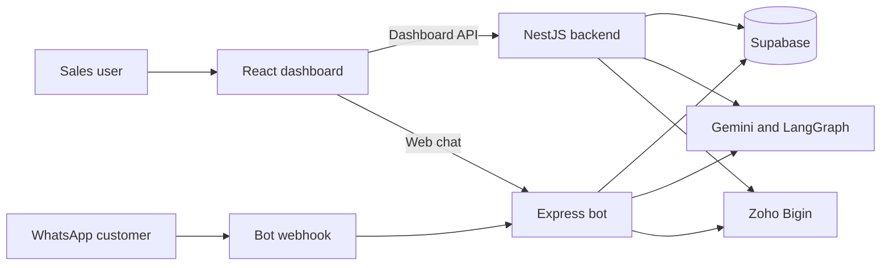

# System architecture

Enlight Metals OS is three deployable Node applications sharing Supabase and external AI/CRM services.

| Application | Responsibility | Entry point |
|---|---|---|
| `em-os-frontend` | Authenticated dashboard, operational workflows, web assistant | `src/main.tsx`, `src/App.tsx` |
| `em-os-backend` | REST API, RBAC, reporting, knowledge base, pricing, CRM endpoints | `src/main.ts`, `src/app.module.ts` |
| `em-os-bot` | WhatsApp and web-chat processing, tools/agents, KRA jobs, Bigin sync | `index.js`, `src/webhook.js` |

The frontend calls the backend through `VITE_BACKEND_URL` and normally reaches bot web chat through `VITE_BOT_URL` (falling back to backend URL). The frontend uses Supabase only for realtime invalidation; the backend and bot independently make operational writes, usually through service-role clients. Avoid assuming the backend mediates bot writes.

Deployment metadata is colocated with each app (`Dockerfile`; backend `railway.json`; frontend `vercel.json`).
