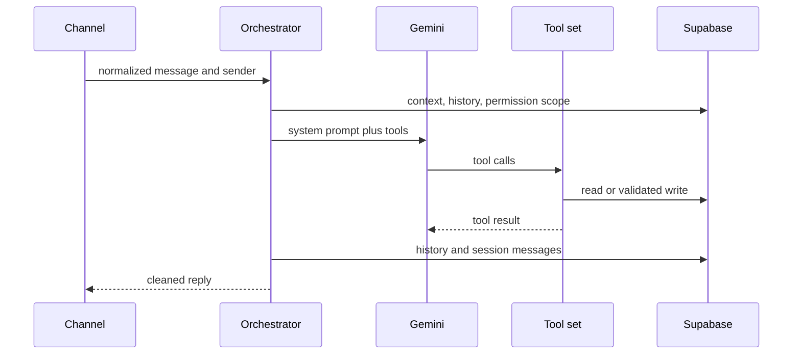

# Orchestrator, session state, and tools

`src/core/orchestrator.js` exports `runOrchestrator`. Per message it creates request-bound tools, concurrently fetches active context, chat history, and accessible salesperson scope, builds a LangGraph state graph, calls Gemini with fallback, executes tool calls, persists conversation/session messages, and applies reply post-processing.

Supporting core files: `tools.js` defines tool contracts; `modelRouter.js` chooses/falls back models; `memory.js` builds active context/history; `sessionManager.js` persists sessions; `pendingStateManager.js` manages interrupted/multi-turn work; `poResolver.js` resolves PO data.

Invariants: scope is fetched once before tools; tool results can be direct-forwarded; reply lists are capped at eight; image data is converted only for model input; history must be recorded on every completed turn. Most free-form mutating tools deliberately return a menu-selection prompt: structured writes belong in `catalogFlow`. Preserve this policy and error/fallback behavior.
