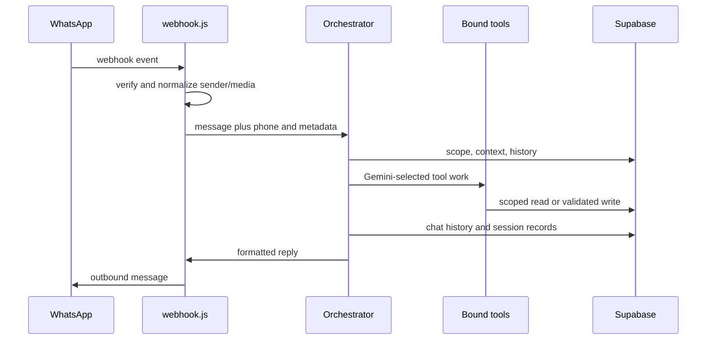

# WhatsApp message lifecycle

Failures must return a user-safe response, log context without sensitive payloads, and not duplicate a mutation when WhatsApp redelivers an event. Trace `webhook.js`, `whatsapp.js`, `core/orchestrator.js`, and `core/tools.js` together.
